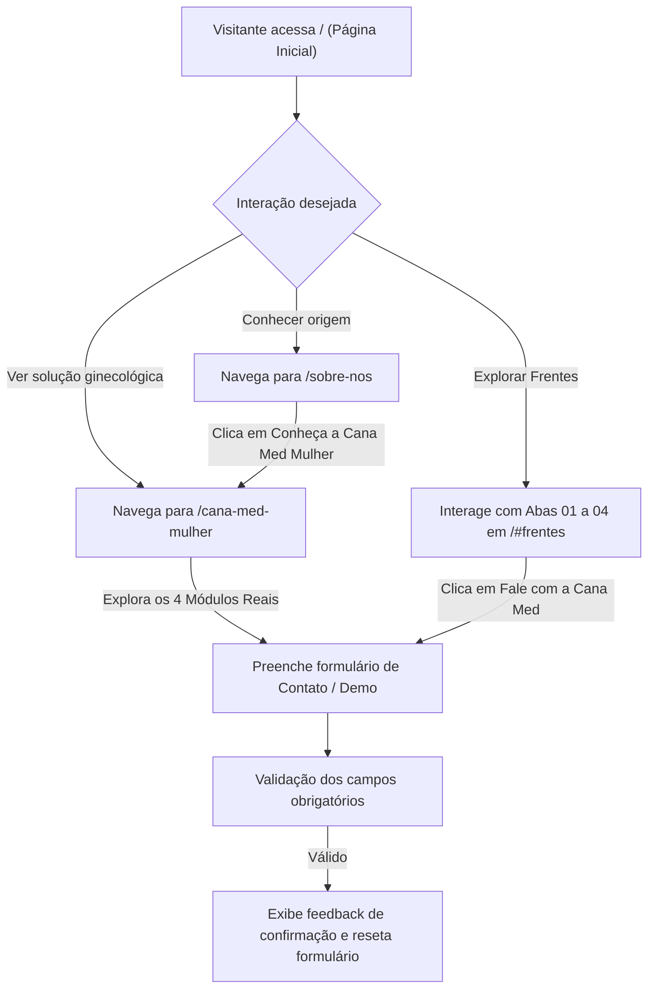

# SPEC-0001 — Construção do Site Institucional Cana Med (Home, Sobre Nós e Cana Med Mulher)

| Campo | Valor |
| :--- | :--- |
| **ID** | SPEC-0001 |
| **Título** | Construção do Site Institucional Cana Med (Home, Sobre Nós e Cana Med Mulher) |
| **Status** | Implementada |
| **Versão** | 1.0 |
| **Data** | 2026-10-16 |
| **Autor** | Planejador (`planejador`) |
| **Revisores** | UI/UX Reviewer (`ui-ux-reviewer`), Medical Systems Domain Expert (`medical-systems-domain-expert`) |
| **Módulos afetados** | frontend institucional (`src/`, `public/assets/`) |
| **ADRs relacionados** | [ADR-0001](../adr/0001-arquitetura-frontend-site-institucional.md) |

---

## 1. Objetivo

Construir o site institucional completo da **Cana Med** com suas três páginas oficiais (**Página Inicial**, **Sobre Nós** e **Cana Med Mulher**), reproduzindo com fidelidade 1:1 a arquitetura de informação, copywriting, interações e design system (`Clinical Precision & Care`) definidos no projeto **Cana Med Institutional Website** do Google Stitch (`projects/16150120632961035693`).

Pergunta de controle do `GEMINI.md`: **isso reduz atrito na rotina da clínica?**
**Sim.** Apresenta de forma clara, ética e transparente como a Cana Med e a Cana Med Mulher eliminam processos manuais e dispersos na recepção, agenda e consultório ginecológico, facilitando a tomada de decisão de gestores e médicos sem promessas irreais.

---

## 2. Contexto

A Cana Med necessita de uma presença institucional própria (`canamed-institucional`) que comunique sua identidade corporativa ("Eficiência para quem mais precisa"), sua origem na engenharia de software aplicada à saúde e sua primeira vertical especializada (**Cana Med Mulher**), exibindo capturas reais do sistema (Agenda & Recepção, PEP Gineco-Obstétrico Longitudinal, Gestão de Retornos CFM e Configurações Operacionais).

---

## 3. Escopo

### 3.1 Dentro do escopo
- Configuração da aplicação React 19 + TypeScript + Vite 6 + Tailwind CSS + React Router v7 + Vitest.
- Configuração integral do Design System `Clinical Precision & Care` (tipografia `Plus Jakarta Sans`, ícones `Material Symbols Outlined`, paleta oficial Cana Med e acentos da linha Cana Med Mulher).
- Mapeamento e utilização exclusiva dos ativos locais oficiais em `public/assets/brand/` e `public/assets/screenshots/`.
- **Componente Compartilhado `Header` (`TopNavBar`):**
  - Variante institucional padrão (logo Cana Med, destaque ativo em `#006565`) usada em `/` e `/sobre-nos`.
  - Variante `Cana Med Mulher` (logo `canamed-mulher-logolonga`, destaque ativo em `#b8186c`) usada em `/cana-med-mulher`.
  - Menu mobile expansível (`aria-expanded`, alternância de ícone `menu`/`close`, fechamento automático ao navegar).
- **Componente Compartilhado `Footer`:**
  - Identidade visual, tagline, links institucionais de navegação, selos de conformidade LGPD/CFM e barra de direitos autorais.
- **Página 1 — Página Inicial (`/`):**
  1. Hero Section Editorial (`#inicio`) com card arquitetural `"Fluxo Operacional Integrado"` (3 etapas + `+40% foco assistencial`) e card `"Adaptação sem atrito"`.
  2. Seção `"O Cenário que Queremos Transformar"` (`#cenario`) com os 3 pontos de dor operacional e faixa `"Tratamento ético e segurança de dados"` (`Conformidade LGPD`).
  3. Seção `"Frentes de Atuação"` (`#frentes`) com painel interativo de 4 abas verticais (`role="tablist"`, suporte a clique e teclado `Enter`/`Space`/`ArrowDown`/`ArrowUp`) e 4 painéis dinâmicos (`role="tabpanel"`):
     - Frente 01: Recepção e cadastro (`Estrutura de Acolhimento Integrado`)
     - Frente 02: Agendamento e agenda (`Visão da Grade Diária`)
     - Frente 03: Fluxo de atendimento (`Sequência sem Fricção`)
     - Frente 04: Contexto clínico & informações (`Contexto de Consulta & Sigilo`)
  4. Seção de destaque `"Cana Med Mulher"` (`#cana-med-mulher`) com logo oficial, 4 diferenciais, card com monograma e CTA para `/cana-med-mulher`.
  5. Seção de Contato & CTA Institucional (`#contato`) com formulário validado (`Nome Completo`, `E-mail Profissional`, `Nome da Clínica`, `Porte / Especialistas`, `Como podemos ajudar?`) e feedback visual de submissão.
- **Página 2 — Sobre Nós (`/sobre-nos`):**
  1. Bloco 1 — Nossa Origem (`ORIGEM & PROPÓSITO`): Hero editorial `"Tecnologia especializada para transformar a gestão em saúde."`, narrativa institucional e 3 indicadores (`Engenharia de Software com Propósito`, `Superação de Processos Arcaicos`, `Soluções Específicas por Realidade`).
  2. Bloco 2 — Destaque `"Nossa Primeira Solução"` (`Cana Med Mulher`): Card com barra superior em degradê (`from-[#d9298a] via-[#a83279] to-[#492268]`), logo oficial, 3 pilares e CTA para `/cana-med-mulher`.
  3. Bloco 3 — Encerramento: Chamada `"Estamos desenvolvendo soluções a partir dos desafios reais de cada contexto da saúde."` com botão `"Conheça nossas soluções"` apontando para `/#frentes`.
- **Página 3 — Cana Med Mulher (`/cana-med-mulher`):**
  1. Seção 1 — Hero da Solução: Badge `"CANA MED • SOLUÇÃO ESPECIALIZADA"`, H1 `"Uma gestão mais organizada para quem cuida da saúde da mulher."`, proof points (`Alinhado às diretrizes CFM`, `Embasamento LGPD`, `Fluxo Obstétrico & Ginecológico`) e Browser Mockup interativo (`app.canamed.local/prontuario`) com print real `22_medico_ficha_ginecologica.png` e indicador `"PEP Ativo"`.
  2. Seção 2 — Contexto Operacional: H2 `"Uma rotina que exige organização em cada etapa."` e 3 cards (`Desafio 01: Agenda e consultas`, `Desafio 02: Informações organizadas`, `Desafio 03: Fluxo de atendimento`).
  3. Seção 3 — Demonstração Interativa (`#conheca-app`): `"Conheça a Cana Med Mulher por dentro."` com 4 módulos em Browser Frames exibindo as capturas reais da plataforma:
     - Módulo 01 (`09_app_agenda_recepcao.png`): `"01 — Organize a agenda e recepção"`
     - Módulo 02 (`22_medico_ficha_ginecologica.png`): `"02 — Gestão especializada gineco-obstétrica"`
     - Módulo 03 (`20_medico_retornos.png`): `"03 — Monitoramento de prazos e retornos clínicos"`
     - Módulo 04 (`14_app_configuracoes.png`): `"04 — Gestão operacional e parâmetros da clínica"`
  4. Seção 4 — Visão de Pessoas: `"Tecnologia que considera quem faz a clínica funcionar."` com 3 cards (`Gestão da clínica`, `Recepção e equipe administrativa`, `Profissionais de saúde`).
  5. Seção 5 — Compromisso Institucional: `"Uma solução pensada para uma rotina que exige cuidado."` com 3 cards (`Usabilidade`, `Privacidade`, `Segurança`).
  6. Seção 6 — Encerramento e Diálogo Institucional (`#contato`): Formulário de demonstração (`Nome completo`, `E-mail corporativo`, `Telefone / WhatsApp`, `Nome da Clínica / Especialidade`, `Como podemos apoiar sua rotina?`) com estado de confirmação e link `mailto:contato@canamed.com.br`.

### 3.2 Fora do escopo
- Autenticação de usuários ou acesso direto ao banco de dados clínico de produção.
- Páginas do Prontuário Eletrônico em si (que residem no repositório principal `canamed`).
- Integração com gateways de pagamento ou CRMs pagos externos nesta fase.

---

## 4. Atores e Permissões

| Ator | Permissão necessária | Observações |
| :--- | :--- | :--- |
| Visitante Público (Médicos, Gestores, Recepcionistas, Pacientes) | Acesso público (`Anonymous`) | Visualização de todas as páginas institucionais e envio de formulário de contato/demonstração. |

---

## 5. Regras de Negócio

| ID | Regra | Justificativa / origem |
| :--- | :--- | :--- |
| RN-001 | Todas as páginas devem utilizar exclusivamente os logotipos e capturas de tela oficiais locais (`/assets/brand/` e `/assets/screenshots/`), sem depender de URLs temporárias externas. | Identidade Visual Oficial (`GEMINI.md` / `docs/identidade-visual.md`). |
| RN-002 | O painel interativo "Frentes de Atuação" na Página Inicial deve iniciar na Frente 01 e permitir alternância imediata entre as Frentes 01, 02, 03 e 04 via clique ou teclado (`Enter` / `Space`), atualizando `aria-selected` e exibindo apenas o painel ativo. | Usabilidade e acessibilidade do protótipo Stitch (`home.html`). |
| RN-003 | A navegação superior (`Header`) e inferior (`Footer`) deve conectar corretamente as 3 rotas (`/`, `/sobre-nos`, `/cana-med-mulher`) e as seções âncora (`/#frentes`, `/#contato`, `/cana-med-mulher#conheca-app`, `/cana-med-mulher#contato`). | Coerência de navegação multi-página. |
| RN-004 | Os formulários de contato (na Home e na página Cana Med Mulher) devem validar campos obrigatórios (`nome`, `email`, e `clinica`/`mensagem` na Home ou `telefone` na página Mulher), exibir estado de envio e apresentar mensagem clara de confirmação após o envio, limpando os campos. | Experiência do usuário e prevenção de envios vazios. |
| RN-005 | Nenhuma comunicação institucional deve prometer automação de diagnóstico médico ou substituir a conduta do profissional de saúde; o discurso deve manter fidelidade às diretrizes do CFM e à LGPD. | Conformidade regulatória (CFM / ANVISA RDC nº 657/2022 / LGPD). |

---

## 6. Fluxos

### 6.1 Fluxo Principal de Navegação e Conversão — F-001

---

## 7. Modelo de Dados

Não aplicável para persistência em banco de dados clínico neste repositório (aplicação frontend institucional).
- **Classificação LGPD dos formulários de contato:** Dados pessoais comuns de contato profissional (`nome`, `email`, `telefone`, `clinica`, `porte`, `mensagem`), tratados exclusivamente para retorno institucional mediante ação voluntária do titular, com aviso explícito de sigilo LGPD junto ao formulário.
- **Nenhum dado sensível de saúde de paciente é coletado no site institucional.**

---

## 8. Contrato de API

Não aplicável nesta fase (submissão de contato processada no cliente com abstração de serviço `submitContactLead` pronta para futura integração com endpoint/webhook institucional).

---

## 9. Interface e Experiência

| Tela / componente | Estado | Comportamento |
| :--- | :--- | :--- |
| `Header` (`TopNavBar`) | Desktop / Mobile Fechado / Mobile Aberto | Exibe links horizontais no desktop; em telas `< 768px`, exibe botão de menu que alterna o drawer mobile (`aria-expanded`) e fecha automaticamente ao selecionar qualquer destino. |
| `FrentesSection` (Abas 01–04) | Aba 1, 2, 3 ou 4 selecionada | Destaca a aba ativa com borda e fundo `mint-subtle`, atualiza `aria-selected="true"` e renderiza o diagrama e os 4 pontos-chave da frente correspondente. |
| `ContactSection` / `MulherContactSection` | Inicial / Enviando / Sucesso / Erro de validação | Valida campos obrigatórios; durante submissão desabilita botão com indicador visual; ao concluir exibe banner de confirmação (`role="status"`). |
| `AppShowcaseSection` (`/cana-med-mulher`) | Visualização padrão | Renderiza os 4 módulos em frames estilo navegador com barra de título, identificador da tela (`09_app_agenda_recepcao`, `22_medico_ficha_ginecologica`, `20_medico_retornos`, `14_app_configuracoes`) e imagem real nítida. |

---

## 10. Critérios de Aceitação

| ID | Critério |
| :--- | :--- |
| CA-001 | **Dado** que o visitante acessa `/`, **Quando** a Página Inicial carrega, **Então** são exibidas as seções Hero (`"Mais eficiência para quem dedica a vida a cuidar."`), Cenário Real (3 cards + selo LGPD), Frentes de Atuação (4 abas interativas), Destaque Cana Med Mulher e Contato. |
| CA-002 | **Dado** que o visitante está na seção Frentes de Atuação em `/`, **Quando** clica ou pressiona `Enter`/`Space` nas abas Frente 02, Frente 03 ou Frente 04, **Então** o painel correspondente passa a ser exibido com seu respectivo diagrama e lista de pontos-chave, e `aria-selected` é atualizado. |
| CA-003 | **Dado** que o visitante acessa `/sobre-nos`, **Quando** a página carrega, **Então** são exibidos o Bloco 1 (`"Tecnologia especializada para transformar a gestão em saúde."` e os 3 indicadores de engenharia), o Bloco 2 (`"Gestão ginecológica pensada para a realidade das clínicas."` com link para `/cana-med-mulher`) e o Bloco 3 de encerramento. |
| CA-004 | **Dado** que o visitante acessa `/cana-med-mulher`, **Quando** a página carrega, **Então** são exibidos o cabeçalho com logo `Cana Med Mulher`, o Hero com mockup do prontuário, os 3 desafios operacionais, os 4 módulos com prints reais (`09_app_agenda_recepcao.png`, `22_medico_ficha_ginecologica.png`, `20_medico_retornos.png`, `14_app_configuracoes.png`), os 3 perfis de equipe, os 3 compromissos (Usabilidade, Privacidade, Segurança) e o formulário de contato. |
| CA-005 | **Dado** que o visitante preenche os campos obrigatórios do formulário de contato em `/` ou `/cana-med-mulher`, **Quando** submete o formulário, **Então** o botão indica o envio e a mensagem de confirmação é exibida na tela. |
| CA-006 | **Dado** que o visitante está em um dispositivo móvel (`< 768px`), **Quando** toca no botão de menu no cabeçalho, **Então** o drawer de navegação abre (`aria-expanded="true"`) e fecha automaticamente ao clicar em qualquer link. |
| CA-007 | **Dado** todas as imagens (``) renderizadas nas 3 páginas, **Quando** inspecionadas, **Então** todas apontam para caminhos locais (`/assets/brand/...` ou `/assets/screenshots/...`) com atributo `alt` descritivo e zero dependência de links `lh3.googleusercontent.com`. |

---

## 11. Casos de Erro

| ID | Gatilho | Comportamento esperado | Mensagem ao usuário | Registro |
| :--- | :--- | :--- | :--- | :--- |
| ER-001 | Submissão de formulário com campos obrigatórios em branco ou e-mail inválido | Impedir o envio e manter os dados já digitados pelo usuário | Validação nativa/contextual nos campos obrigatórios | N/A (validação client-side) |
| ER-002 | Acesso a rota inexistente (ex.: `/pagina-inexistente`) | Redirecionar de forma segura para `/` ou exibir estado amigável com retorno para a Home | Link claro de retorno para a Página Inicial | N/A |

---

## 12. Impacto em Outras Funcionalidades

| Funcionalidade / módulo | Tipo de impacto | Ação necessária |
| :--- | :--- | :--- |
| Repositório principal `canamed` | Nenhum impacto direto (repositório isolado `canamed-institucional`) | Manter sincronia visual com os ativos de `assets/brand/` e `assets/screenshots/`. |

---

## 13. Requisitos de Segurança

- [x] Nenhum segredo, token ou chave privada no código-fonte ou repositório.
- [x] Prevenção contra XSS (renderização segura via JSX sem `dangerouslySetInnerHTML` com entrada de usuário).
- [x] Nenhum dado real de paciente nas páginas, imagens ou testes (as capturas de tela utilizam exclusivamente dados fictícios de demonstração).
- [x] Aviso explícito de compromisso ético e sigilo LGPD junto aos formulários de contato.

---

## 14. Requisitos Legais Aplicáveis

| Norma | Aplicável? | O que exige nesta funcionalidade |
| :--- | :--- | :--- |
| LGPD (Lei nº 13.709/2018) | Sim | Transparência sobre a finalidade de contato institucional e minimização dos dados coletados no formulário. |
| CFM / NGS2 | Sim (comunicação) | Apresentar de forma fidedigna os recursos de suporte ao prontuário e carência de retornos conforme diretrizes do CFM. |
| ANVISA RDC nº 657/2022 | Sim (comunicação) | Posicionar o software estritamente como plataforma de gestão clínica e prontuário organizacional, sem prometer diagnóstico automatizado (SaMD). |

---

## 15. Requisitos Não Funcionais

| Categoria | Requisito |
| :--- | :--- |
| Desempenho | Build de produção enxuto via Vite 6; carregamento imediato de fontes e ativos locais. |
| Acessibilidade | Semântica HTML5 (`header`, `nav`, `main`, `section`, `footer`), atributos ARIA nas abas (`role="tablist"`, `role="tab"`, `role="tabpanel"`, `aria-selected`) e no menu mobile (`aria-expanded`), contraste WCAG AA. |
| Responsividade | Layout fluido adaptado para Mobile (`< 768px`), Tablet (`768px–1199px`) e Desktop (`≥ 1200px`). |

---

## 16. Testes Previstos

| Tipo | Cobertura mínima |
| :--- | :--- |
| Unitário / Componentes (Vitest + RTL) | Renderização e navegação do `Header`/`Footer`, páginas `HomePage`, `AboutPage`, `CanamedMulherPage`, alternância por clique/teclado das 4 abas em `FrentesSection`, submissão dos formulários de contato e verificação de ativos locais. |
| Build & Tipagem | `tsc --noEmit` e `vite build` sem erros ou avisos impeditivos. |

---

## 17. Auditoria e Observabilidade

Não aplicável para trilha de prontuário (site institucional público sem manipulação de registros clínicos). As ações de engenharia dos agentes são registradas em [`docs/CHANGELOG_AGENTE.md`](../docs/CHANGELOG_AGENTE.md).

---

## 18. Pendências e Questões Abertas

Nenhuma pendência bloqueadora. Todos os textos, layouts e ativos das 3 páginas estão integralmente definidos nos protótipos do Stitch.

---

## 19. Histórico de Revisões

| Versão | Data | Autor | Alteração |
| :--- | :--- | :--- | :--- |
| 1.0 | 2026-10-16 | Planejador | Criação inicial da SPEC-0001 com base no projeto `Cana Med Institutional Website` do Stitch MCP. |

---

## 20. Aprovação

| Papel | Nome | Data | Status |
| :--- | :--- | :--- | :--- |
| Autor | Agente Planejador | 2026-10-16 | Concluído |
| Revisor UI/UX | UI/UX Reviewer | 2026-10-16 | Aprovado |
| Aprovador | Usuário | Pendente | Aguardando revisão do plano |
